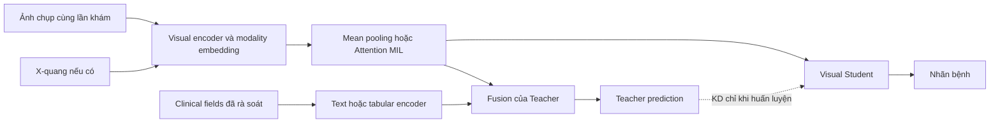

# Kế hoạch phát triển khóa luận ClinDistill — COde chính, MeMoSA phụ

Ngày lập: 05/10/2026. Cơ sở: review 23 trang, Seminar.png, các PDF COde, MeMoSA, MMPKD, các phần phương pháp liên quan của TriDeNT và oral multimodal fusion; kiểm tra notebook và dữ liệu COde tại workspace. GPU: người thực hiện xác nhận dùng Kaggle và có tài nguyên đủ tốt. Chưa có hạn nộp cụ thể; tiến độ dưới đây là khung 16 tuần, không phải ngày cam kết.

## 1. Định hướng nên chốt

Tên gợi ý: **Học đa ảnh với chưng cất chọn lọc thông tin lâm sàng ưu tiên cho phân loại bệnh lý răng miệng chỉ từ ảnh**.

Tên tiếng Anh: **Selective Privileged Clinical-Context Distillation for Multi-Image Oro-Dental Classification**.

Một mẫu COde là một lần khám: tập ảnh chụp miệng, tập ảnh X-quang nếu có, các trường lâm sàng, và nhãn bệnh. Teacher sử dụng ảnh và thông tin lâm sàng trong huấn luyện. Student nhận các ảnh của lần khám và dự đoán nhãn mà không cần hồ sơ lâm sàng khi suy luận. “Chỉ từ ảnh” vẫn cho phép X-quang; chế độ chỉ ảnh chụp miệng là một thí nghiệm riêng.

Ba câu hỏi nghiên cứu:

1. Gom nhiều ảnh cùng lần khám có cải thiện so với một ảnh, khi cố định backbone và cách chia tập không?
2. Teacher có thêm thông tin lâm sàng có giúp Student chỉ dùng ảnh tốt hơn huấn luyện trực tiếp không?
3. Chọn lọc theo nhóm trường lâm sàng có cải thiện so với KD đồng đều, đặc biệt khi thông tin thiếu hoặc ít liên quan đến dấu hiệu trong ảnh không?

Đóng góp dự kiến là protocol theo bệnh nhân, hệ thống multi-image, và kiểm chứng selective clinical distillation. Chỉ gọi selective KD là đóng góp phương pháp sau khi xác định cơ chế cụ thể, đối chiếu prior art và có ablation hỗ trợ. Việc ghép Teacher–Student, MIL và text encoder đơn thuần không đủ để khẳng định phương pháp mới. Không đặt điều kiện phải đạt Q1/Q2 hoặc phải vượt một mức accuracy có sẵn để khóa luận được coi là hoàn thành.

## 2. Những phát hiện từ dữ liệu thật

Kết quả tái tạo được bằng `python research-notes/audit_code.py`; số liệu đầy đủ ở `code_audit_summary.json`.

| Hạng mục | Kết quả kiểm tra cục bộ | Hệ quả cho nghiên cứu |
|---|---:|---|
| CSV gốc | 8.775 lần khám, 4.800 bệnh nhân | Một dòng CSV làm đơn vị chuẩn |
| Split CSV | 8.175 train, 600 test; 245 bệnh nhân giao nhau | Tạo split bệnh nhân mới cho kết luận chính |
| JSON classification | 14.696 train, 1.793 test | Các biến thể câu hỏi/ngôn ngữ không phải ca độc lập |
| Test JSON | 600 lần khám, 572 bệnh nhân | Đánh giá chính ở cấp lần khám |
| Giao bệnh nhân JSON train/test | 224 | Checkup không trùng chưa đủ đảm bảo độc lập |
| Ảnh chụp | 49.938 JPG | Khác con số 50.000 trong paper; báo cáo theo bản đang dùng |
| X-quang | 8.056 JPG | Đường dẫn ảnh trong CSV đều có file tương ứng |
| Lần khám không có X-quang | 4.519/8.775, khoảng 51,5% | Mô hình phải hỗ trợ thiếu modality |
| `radiographs_examination` rỗng | 6.694/8.775, khoảng 76,3% | Không giả định mọi ca đều có mô tả X-quang |
| `past_medical_record` rỗng | 4.519/8.775 | Cần mask trường thiếu |
| `anomalies_en` rỗng | 1.121/8.775 | Không tự gán là ca khỏe mạnh |
| Train JSON không có ảnh | 3 dòng | Cần loại hoặc giải quyết khi dựng manifest |

Đây là audit cấu trúc: chưa giải mã ảnh hỏng, hash ảnh trùng hay kiểm định nội dung nhãn. Số liệu không cho biết mức tăng điểm do giao bệnh nhân; nó chỉ chứng minh split hiện tại không đáp ứng đánh giá trên bệnh nhân chưa từng thấy.

`explore-data.ipynb` hiện chủ yếu tải, giải nén, liệt kê file và xem vài dòng; chưa có audit nhãn/split hoặc EDA theo lần khám. `run-all-2.ipynb` đã có pipeline Qwen reproduction và output một phần; chưa thấy kết quả fine-tuned hoàn chỉnh trong các output được lưu. Có thể giữ làm nhánh tham khảo, nhưng cần kiểm tra lại việc chia validation sau augmentation.

## 3. Định nghĩa tác vụ và nhãn

### COde

Ưu tiên khảo sát **multi-label cấp lần khám trên sáu nhóm mục tiêu**: Caries, Gingivitis, Malocclusion, Pulpitis, Tooth Loss, Tooth Structure Loss. Nhãn lấy từ `anomalies_en`, với mapping có phiên bản, không lấy nguyên câu trả lời ShareGPT làm tên class.

Mapping sơ bộ gộp Malocclusion và Class I/II/III Malocclusion cho thấy 6.055 lần khám có đúng một nhóm mục tiêu, 627 có từ hai nhóm trở lên, 2.093 không có nhóm nào trong mapping. Đây chỉ là thống kê thăm dò: không tự gộp các tình trạng khác như crowding vào malocclusion khi chưa được rà soát. Các dòng không có nhóm mục tiêu bao gồm cả thiếu annotation và bệnh ngoài phạm vi, không đồng nghĩa “normal”.

Trong tuần 1–2 cần chốt một trong hai protocol:

- Nếu mức đầy đủ nhãn đủ để dùng absent-as-negative, dùng sigmoid + BCE trên sáu nhãn. Nêu rõ đây là dự đoán bệnh được ghi nhận trong hồ sơ; rà soát một tập mẫu có phân tầng theo bệnh để đánh giá bỏ sót nhãn. Khi có nhãn chưa xác định, dùng mask; không gọi tất cả phần vắng là âm tính đã xác nhận.
- Nếu chưa đủ cơ sở cho nhãn âm, core khả thi là phân loại sáu lớp trên các ca có đúng một nhóm mục tiêu đã xác nhận. Báo cáo rõ cohort này là tập con chọn lọc, các bệnh khác vẫn có thể cùng tồn tại; không suy rộng thành chẩn đoán toàn bộ COde. Multi-label trở thành mở rộng.

Chốt task trước khi huấn luyện các baseline chính; không đổi cohort/loss giữa các phương pháp. Không so trực tiếp điểm của protocol mới với F1 79,39% trong paper COde như cùng điều kiện: input, split, đối tượng đánh giá và cách averaging có thể khác. Benchmark sáu lớp gốc có thể được tái hiện ở một bảng riêng. [Nguồn COde](https://www.nature.com/articles/s41597-026-07342-9).

### MeMoSA

Vai trò: kiểm chứng lại phương pháp trên dữ liệu niêm mạc miệng với cấu trúc clinical context khác. Huấn luyện và đánh giá độc lập, đầu ra riêng; không dùng trực tiếp head bệnh răng của COde để dự đoán ung thư/OPMD.

Paper mô tả 30.039 ảnh, 6.426 người, sáu nhóm lesion; nhãn nằm ở cấp ảnh và dữ liệu có follow-up. Filename cung cấp country/cohort/patient, nhưng mô tả công khai không đủ đảm bảo có encounter ID. Cần xin dữ liệu và xác minh khóa nhóm, mốc thời gian, lesion/site và tính nhất quán nhãn. Không nhóm toàn bộ ảnh cùng bệnh nhân qua nhiều thời điểm; không dùng nhãn đích để tạo bag. Nếu không xác định được bag hợp lệ, dùng single-image với split theo bệnh nhân và nói rõ nhánh này chỉ kiểm chứng distillation, chưa kiểm chứng multi-image. [Nguồn MeMoSA](https://www.nature.com/articles/s41597-026-06998-7).

MeMoSA chưa hiện diện trong thư mục Data được kiểm tra. Cần bắt đầu quy trình xin quyền ngay tuần 1. Đây là việc người làm khóa luận thực hiện qua Workbench, không đợi COde hoàn tất. Nếu quyền truy cập chậm, tiếp tục core COde và ghi MeMoSA là phần chưa hoàn thành; không thay tên một thí nghiệm nội bộ thành external validation.

## 4. Protocol dữ liệu cần hoàn thành trước model

1. Dựng manifest một dòng/lần khám: `patient_id`, `case_id`, danh sách photo, danh sách radiograph, safe clinical fields, missing masks, labels, label masks, split.
2. Chia theo `patient_id`, ví dụ mục tiêu 70/15/15, cân bằng phân bố nhãn ở mức nhóm trong khả năng cho phép. Tất cả lần khám và bản EN/CN/QA của cùng người thuộc một partition. Cố định seed và danh sách ID.
3. Dò ảnh giống hệt bằng hash và ảnh gần trùng bằng perceptual hash; rà soát nhóm nghi vấn để không chia ảnh sao chép qua các tập. Checkup ID và patient ID không được đưa thành feature.
4. Chỉ fit chuẩn hóa, imputation, class weights, vocabulary và chọn threshold từ train/validation đúng vai trò. Không dùng test để chọn trường lâm sàng, checkpoint hoặc hệ số KD.
5. Rà soát ngôn ngữ: ban đầu dùng EN thống nhất; EN và CN không trở thành hai bệnh nhân hay hai ca độc lập. Bản dịch và từ phủ định cần được kiểm tra trên mẫu.
6. Dùng padding mask cho số ảnh biến thiên; tập train có thể sample số ảnh có giới hạn, validation/test dùng quy tắc cố định hoặc toàn bộ ảnh. Các model trong cùng so sánh dùng cùng ngân sách ảnh.
7. Teacher và Student trong thí nghiệm cô lập clinical KD dùng cùng tập ảnh. Nếu Teacher được thêm X-quang hoặc thêm view, đó là một thí nghiệm privileged visual modality khác và phải được ghi riêng.
8. Với ảnh trước/sau điều trị, rà soát sự phù hợp thời điểm và target; một mã checkup không tự đảm bảo mọi ảnh đều phản ánh cùng trạng thái bệnh.

Split gốc chỉ phục vụ tái hiện benchmark nếu cần. Kết quả patient-disjoint là bằng chứng chính của khóa luận.

## 5. Phân nhóm clinical context và chống lộ nhãn

| Nhóm | Trường ứng viên | Cách dùng |
|---|---|---|
| V: có thể mô tả dấu hiệu trong ảnh | `examination`, `radiographs_examination` | Teacher V sau rà soát từng nội dung; mô tả X-quang chỉ được gọi là grounded khi có ảnh phù hợp |
| H: triệu chứng/tiền sử | `chief_complaint`, `present_illness`, `past_medical_record` | Teacher H hoặc full Teacher; không giả định Student có thể suy ra chính xác từ ảnh |
| Metadata | age, gender; MeMoSA risk factors nếu có | Nhánh tabular, missing mask; ablation riêng và kiểm tra shortcut |
| Không đưa vào input chính | `anomalies_*`, `diagnosis*`, `patient_record*`, treatment, management, instructions, recommendations, remarks chưa kiểm duyệt | Target hoặc thông tin có thể tiết lộ quyết định/chẩn đoán |

`patient_record` dễ chứa phần “Diagnosis” dù không có tên là diagnosis. Các trường complaint/examination cũng có thể nhắc trực tiếp bệnh, quyết định điều trị hoặc khám không thể nhìn thấy như đo túi nha chu, gõ đau, thử tủy. Vì vậy nhóm V chỉ là prior thao tác, không phải nhãn “nhìn thấy được” đã được chứng minh.

Xây allowlist, kiểm tra tên bệnh/đồng nghĩa/FDI, và rà soát thủ công hoặc cùng giảng viên/chuyên gia một tập mẫu, ví dụ 100–200 ca phân tầng trong train. So sánh bản giữ mô tả đã duyệt với bản che tên target. Không xóa từ tùy tiện làm mất phủ định hoặc đặc điểm hình thái. Thông tin hậu chẩn đoán hợp lệ cho một số thiết lập LUPI, nhưng chứa nguyên target không đủ chứng minh đã chuyển được kiến thức lâm sàng hữu ích; cần tách thành oracle/control nếu nghiên cứu.

## 6. Kiến trúc và thứ tự huấn luyện

Sơ đồ biểu diễn luồng dữ liệu; Teacher và Student nên là các model độc lập khi Teacher được đóng băng, không vô tình cập nhật cùng một bộ trọng số dùng chung.

- Prototype: một CNN pretrained cỡ vừa, ví dụ ResNet-50, mean pooling rồi Attention MIL. Chọn một backbone chính và giữ cố định cho ablation. MIL phù hợp vì nhận tập ảnh biến thiên và nhãn cấp bag. [Attention MIL](https://proceedings.mlr.press/v80/ilse18a.html).
- Photo và radiograph có modality embedding/mask; có thể dùng encoder riêng nếu ablation chứng minh lợi ích. Không chọn riêng các ca đủ cả hai rồi coi kết quả đại diện toàn dataset.
- Teacher khởi đầu: visual bag vector nối text embedding và metadata, qua MLP. Có thể dùng biomedical text encoder cho EN, nhưng phải kiểm tra tokenization và truncation trên hồ sơ thực tế.
- Thiết kế nâng cao: Set Transformer cho tương tác giữa ảnh, sau khi mean/MIL đã chạy ổn. [Set Transformer](https://proceedings.mlr.press/v97/lee19d.html).
- Huấn luyện visual baseline; huấn luyện Teacher trên train; chọn checkpoint trên validation; đóng băng Teacher; huấn luyện Student với supervised loss và KD. Student baseline và Student KD có cùng kiến trúc, initialization policy và lịch train công bằng.
- Không yêu cầu Qwen 7B để core hoàn thành. GPU tốt nên dành thêm cho nhiều seed, kiểm định và backbone robustness; không thêm mọi loss cùng lúc.

## 7. Cơ chế selective KD có thể triển khai và kiểm chứng

Baseline single-label:

`L = L_sup + lambda * T^2 * KL(softmax(z_teacher/T) || softmax(z_student/T))`.

Với multi-label, dùng BCE cho ground truth và distillation theo từng phân phối Bernoulli sigmoid; không dùng softmax cạnh tranh giữa những bệnh có thể đồng thời xuất hiện.

**Phiên bản đề xuất đầu tiên:** tách Teacher V (ảnh + nhóm V) và Teacher H (ảnh + nhóm H); có Teacher full làm đối chứng. Student học từ hai soft targets với trọng số riêng:

`L = L_sup + lambda * T^2 * [w_V * D(p_V, p_S) + w_H * D(p_H, p_S)]`.

Khởi đầu chỉ dùng trọng số cố định chọn trên validation, thử bằng nhau, V cao hơn H, và H cao hơn V. Dùng field dropout lúc huấn luyện các Teacher để chịu được thiếu trường. Khi toàn bộ clinical group không có dữ liệu cho một mẫu, dùng availability mask; chuẩn hóa trọng số trên các term khả dụng, và dùng supervised loss khi không có term nào. Giữ cùng cách mask cho các đối chứng.

Cơ chế này chuyển “field-aware” thành những target phân biệt được, dễ ablate. Chỉ nhân một trọng số vào loss của Teacher full thì đó là sample weighting, chưa chứng minh chuyển chọn lọc theo field. Các nhánh Teacher khác nhau cũng tăng số tham số và chi phí, do đó cần báo cáo chi phí và đối chứng ensemble/equal weights trước khi quy cải thiện cho prior về field.

Sau khi bản cố định có tín hiệu mới thử gating theo mẫu, học trên train hoặc calibration folds, chọn siêu tham số trên validation. Gating không được tối ưu trực tiếp validation labels rồi lại dùng validation đó làm bằng chứng độc lập. Teacher confidence/agreement chỉ là heuristic; không đồng nhất với “thông tin nhìn thấy từ ảnh”. Đừng ép `w_H = 0` như chân lý: metadata không nhìn thấy trực tiếp vẫn có thể cải thiện soft targets.

So sánh vanilla KD với field-aware KD cần giữ cùng student và budget tuning. Nếu muốn bám sát MMPKD, bổ sung teacher **chỉ clinical**: paper MMPKD gốc không dùng teacher ảnh + clinical như Teacher full đề xuất. MMPKD cũng không bảo đảm tăng predictive AUROC ở mọi dataset. [MMPKD](https://arxiv.org/abs/2508.06558).

Feature KD và relation KD chỉ thêm từng thành phần sau đó. Không ép toàn bộ fused feature giàu history bằng feature Student khi chưa có giả thuyết và baseline hỗ trợ.

## 8. Ma trận thí nghiệm

| ID | Thí nghiệm | Câu hỏi |
|---|---|---|
| E0 | Audit, mapping, patient split | Dữ liệu có phù hợp protocol không? |
| E1 | Single-photo; bổ sung single-X-ray trên cohort thích hợp | Mốc một ảnh |
| E2 | Multi-image mean pooling | Lợi ích của nhiều ảnh |
| E3 | Multi-image Attention MIL | Lợi ích pooling có học |
| E4 | Clinical-only Teacher | Clinical fields chứa signal/shortcut nào? |
| E5 | Ảnh + clinical full Teacher | Giá trị tăng thêm của clinical context |
| E6 | Student + vanilla KD từ E5 | KD có chuyển được lợi ích không? |
| E7 | Field-separated Teacher + equal weights | Đối chứng kiến trúc/ensemble |
| E8 | Selective KD, cùng Student | Đóng góp riêng của lựa chọn trọng số |
| E9 | Lặp E3/E5/E6/E8 trên MeMoSA | Khả năng lặp lại phương pháp trên domain khác |

E1–E3 so sánh số ảnh trên cùng cohort photo; thí nghiệm thêm X-quang giữ số ảnh chụp và cohort tương thích. Nếu E3 dùng thêm modality so với E1, ghi rõ improvement tổng hợp chưa tách riêng hiệu ứng multi-image.

Các ablation cần ưu tiên: photo-only/photo+X-ray; V-only/H-only/full; mask target names; equal/selected weights; field dropout; số ảnh/bag. Set Transformer, backbone thứ hai, feature KD là mở rộng. Thử bỏ một nhóm ảnh ở test cần đối chiếu với mô hình đã được train modality dropout; phân biệt thiếu tự nhiên và thiếu nhân tạo.

Khảo sát config dùng một seed; khóa các lựa chọn bằng validation. Chạy ít nhất ba seed cho E3, E5, E6, E8, năm nếu khả thi. Không chạy toàn bộ tích Descartes backbone × loss × trường × seed ngay từ đầu.

## 9. Đánh giá và giới hạn kết luận

- Multi-label: macro average precision (mAP) làm chỉ số chính, micro/macro F1 và recall từng nhãn làm phụ; threshold chọn trên validation. Single-label: macro-F1 chính, balanced accuracy, confusion matrix, per-class recall và one-vs-rest AUROC phụ.
- Báo cáo ở cấp lần khám, bootstrap theo bệnh nhân vì một người có nhiều lần khám. Mean ± SD qua seed đo độ biến thiên tối ưu hóa; CI bootstrap theo bệnh nhân đo độ bất định do tập dữ liệu. Hai loại không thay thế nhau.
- Với nhãn quá ít positive trong test, báo cáo số lượng và metric không xác định thay vì tự gán 0 hoặc bỏ âm thầm. Báo cáo test support, không chỉ giá trị trung bình.
- Teacher có thông tin nhiều hơn là tham chiếu thực nghiệm, không phải upper bound toán học. So sánh cùng task/cohort và giải thích khi Teacher không vượt Student.
- Chia nhóm theo có/không X-quang, số ảnh, clinical missingness; MeMoSA thêm chất lượng ảnh, cohort/site nếu đủ metadata. Country/site holdout là mở rộng khi đủ support nhãn.
- Đo ECE/Brier và risk–coverage/AURC cho khả năng từ chối ca khó nếu có thời gian. AURC đo selective prediction, không phải nhãn thật “cần thông tin lâm sàng”.
- Nếu thiết kế clinical dependency score từ teacher–student loss gap, chỉ gọi là proxy của lợi ích model; dùng dự đoán out-of-fold ở train khi sinh supervision phụ. Không suy ra nhu cầu khám lâm sàng thật nếu thiếu đánh giá chuyên gia.
- Attention/Grad-CAM phục vụ phân tích lỗi định tính; không chứng minh localization đúng khi không có annotation vùng/răng.
- Lặp phương pháp trên MeMoSA là xác nhận trên dataset khác, không phải external validation cùng một classifier sáu bệnh COde. Hai bộ không chung không gian nhãn.

## 10. Tiến độ tham chiếu 16 tuần

| Tuần | Công việc | Đầu ra và điểm quyết định |
|---|---|---|
| 1–2 | Xin MeMoSA; audit COde; mapping nhãn; rà soát field; patient split | Manifest, label policy, split và báo cáo EDA; chốt single/multi-label |
| 3–4 | Single-image, mean pooling, Attention MIL | E1–E3 chạy ổn; kiểm tra model xử lý padding/thiếu modality |
| 5–6 | Clinical-only và multimodal Teachers | E4–E5; kiểm tra gain, leakage, missingness |
| 7–8 | Vanilla KD; debug temperature và loss | E6; quyết định có bằng chứng để phát triển selective |
| 9–10 | Teachers theo field, equal weights, selective weights | E7–E8 và ablation field; viết phương pháp |
| 11–12 | MeMoSA adapter, grouping, baseline/Teacher/KD | E9 theo điều kiện truy cập và chất lượng grouping |
| 13–14 | Khóa config; nhiều seed; CI; missing-modality, error analysis | Bảng kết quả cuối, số ca theo nhóm, đồ thị calibration |
| 15–16 | Hoàn thiện báo cáo, tái chạy từ config, slide và demo Student | Bản khóa luận, checkpoint, hướng dẫn tái lập, tài liệu bảo vệ |

Viết song song: tuần 1–2 hình thành đặt vấn đề; tuần 3–6 related work và dữ liệu; tuần 7–10 methodology; tuần 11–14 kết quả. Dự phòng thêm 2–4 tuần nếu tiến độ chính thức cho phép. Nếu chỉ có 8–10 tuần, giảm Set Transformer/backbone thứ hai/uncertainty, vẫn giữ split sạch, baseline, vanilla/selective comparison và đánh giá nhiều seed.

Các điểm dừng để tránh mở rộng vô hạn:

- Teacher không có gain ổn định: kiểm tra độ thiếu text, alignment, chất lượng nhãn, overfit trước khi thêm loss. Vẫn có thể khảo sát KD, nhưng không mặc định clinical context hữu ích.
- Selective không hơn vanilla: báo cáo trung thực, phân tích khi nào có/không có lợi ích; không chọn riêng một seed đẹp. Một nghiên cứu thực nghiệm có protocol tốt vẫn là kết quả hợp lệ.
- MeMoSA thiếu encounter ID: chuyển nhánh phụ về single-image, giới hạn kết luận. Không tự suy đoán thời điểm từ thứ tự ảnh.
- MeMoSA chưa được cấp quyền: hoàn thiện core COde và trình bày rõ phần chưa kiểm chứng với người hướng dẫn.

## 11. Công việc nên làm ngay trong tuần đầu

1. Nâng `explore-data.ipynb` từ xem file thành audit theo patient/checkup: nhãn, missingness, số ảnh, ảnh lỗi/trùng, phân bố split.
2. Dùng CSV làm nguồn chuẩn, xuất manifest và label mapping có phiên bản; không random split các dòng QA.
3. Chọn và kiểm tra mẫu hồ sơ phân tầng cho field policy và label completeness.
4. Tạo patient-disjoint split, lưu ID cố định và báo cáo class support.
5. Chốt mục tiêu inference: photo+X-ray nếu có là core visual-only; photo-only là ablation rõ ràng.
6. Dựng một baseline mean-pooling trên tập con để kiểm tra pipeline; sau đó chạy full train/validation, chưa dùng test để quyết định thiết kế.
7. Xin quyền MeMoSA và xác minh encounter/lesion identifiers.

Sản phẩm cuối tối thiểu: manifest/split, audit report, một visual baseline mạnh, multimodal Teacher, vanilla KD, selective KD cùng các đối chứng, nhiều seed và phân tích lỗi; MeMoSA là nhánh kiểm chứng bổ sung theo kế hoạch. Student demo chỉ nhận ảnh, không vô tình đọc metadata hoặc clinical text lúc inference.

## 12. Nguồn và phạm vi đọc

- `ClinDistill_Literature_Review_CODe_MeMoSA_2026.pdf`: đã đọc toàn bộ 23 trang; các trang 18–23 là cơ sở cho scope và ablation.
- `Seminar.png`: đã xem sơ đồ; nhiều hướng trong ảnh được phân cấp core/mở rộng trong kế hoạch này.
- `COde.pdf`: đã đọc dataset, benchmark và tổ chức dữ liệu; đối chiếu thống kê với bản local.
- `MeMoSA dataset.pdf`: đã đọc các phần dữ liệu, metadata, grouping, label verification và access liên quan trực tiếp. Paper cho biết chỉ một phần nhỏ ảnh có biopsy; không gọi toàn bộ dataset là nhãn mô bệnh học đã xác nhận.
- `On the effectiveness of multimodal privileged.pdf`: đã đọc toàn bộ; dùng làm baseline privileged KD, lưu ý teacher clinical-only và benefit phụ thuộc task.
- `TriDeNT.pdf`, `s41598-026-52410-0.pdf`: đọc phần giới thiệu/phương pháp liên quan; không coi là đã tái tạo các mô hình này.
- Attention MIL và Set Transformer: đối chiếu nguồn PMLR chính thức, link trong phần kiến trúc.
- CPKD: hiện dựa vào review; lần truy cập DOI để kiểm chứng không thành công. Cần đọc full paper/code trước khi khẳng định khác biệt chi tiết hay tái tạo baseline CPKD.

Đây là kế hoạch nghiên cứu và kiểm tra sơ bộ dữ liệu, không phải báo cáo kết quả huấn luyện mới. Những cơ chế và mức cải thiện đề xuất là giả thuyết cần thực nghiệm.
