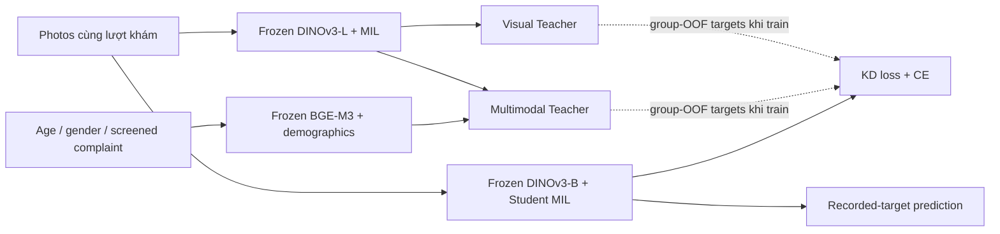

# ClinDistill — seminar theo implementation hiện hành

**Privileged Clinical-Context Distillation for Selected-Cohort Multi-Image Dental Classification**

Phạm vi0.6.0: CODe photo-only, sáu target được ghi nhận, frozen foundation encoders. Một lượt khám là một sample có nhiều ảnh. Không có healthy class và chưa phải mô hình chẩn đoán mọi ca nha khoa.

Student forward/inference chỉ nhận photos; labels/Teacher targets chỉ vào loss khi train. Clinical-only control có model riêng không nhận ảnh; nó dùng để kiểm tra signal/shortcut trong clinical.

| Câu hỏi | Đối chứng | Trạng thái |
|---|---|---|
| Nhiều ảnh có lợi? | Single vs mean vs attention, cùng Student backbone | Phần mềm sẵn, chưa có full results xác nhận |
| Clinical có signal bổ sung? | Visual/MM, clinical-only, demographics, shuffle, masked architecture | Phần mềm sẵn; content/timing review còn mở |
| Transfer có lợi? | no-KD vs Visual KD vs MM KD | OOF/schedule/checks có sẵn; hiệu quả chưa xác nhận |
| Weighting đóng góp gì? | Confidence/correctness/support/reliability, weighted CE, label smoothing | Giả thuyết exploratory |

Thứ tự: **visual → clinical → transfer → mở rộng**, chọn trên train/validation, khóa protocol trước test. Reliability gate là heuristic theo mẫu, chưa đo visual sufficiency và chưa chọn lọc từng clinical field. Attention/risk–coverage không chứng minh nhu cầu khám lâm sàng.

Hiện đã có data audit và log feature extraction cung cấp trước đây. Synthetic checks kiểm chứng phần mềm; full pretrained training/test, latency/VRAM cấp lượt khám, annotation/clinical/near-duplicate reviews còn phải làm.

X-ray/CBCT, MeMoSA, multi-label với complete negatives, tooth/region heads, encoder fine-tuning và clinical-dependency supervision chưa thuộc implementation này. Không hiển thị điểm F1 minh họa như kết quả thực nghiệm.

[Plan](CODe_Research_Implementation_Plan.md), [hướng dẫn chạy](Khóa%20luận/README.md), [chỉ mục tài liệu](Paper/README.md). [Poster ban đầu](docs/archive/Seminar-original.png) giữ để đối chiếu lịch sử; nó có phạm vi rộng và một số metadata sai, không dùng làm mô tả kết quả hiện hành.
